<p align="center">
  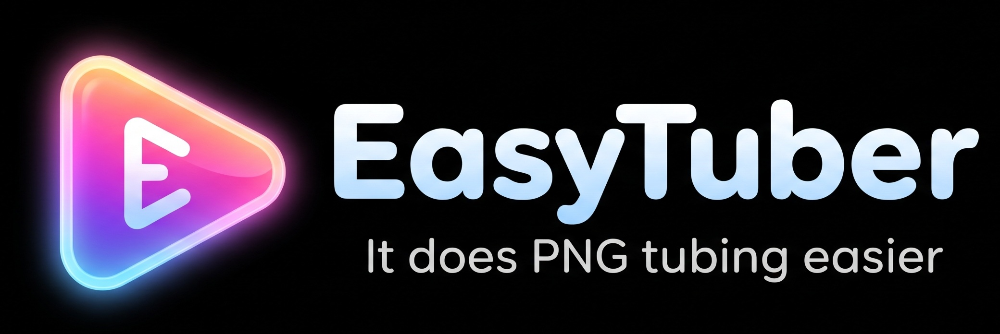
</p>

<p align="center">
  <a href="https://github.com/pjcjonas/EasyTuber/releases/latest"><b>Download for Windows or Mac</b></a> ·
  <a href="#video-tutorial"><b>Watch the video tutorial</b></a>
</p>

https://github.com/user-attachments/assets/f4ea52c9-6cbb-42f4-941d-913532157c47

# EASY-TUBER

A desktop PNGTuber maker with a built-in skeleton. You upload the body parts of your character, line them up once, and your avatar **breathes, blinks, talks to your microphone, bobs its head, swings its hair and gestures with its arms**. All the motion is pre-configured; you only choose how strong it is. Then you put it in OBS with a transparent background.

Nothing is uploaded anywhere. Your microphone and your art stay on your computer.

https://github.com/user-attachments/assets/8711d20d-2a99-4d6d-908e-319c25ee7503

## Video tutorial

A narrated walkthrough (4:31): uploading your art, lining up the rig, eyes and mouth, sprite sheets, the microphone, motion, switching avatars with hotkeys, and streaming in OBS. Click the picture to download and play it.

<a href="https://github.com/pjcjonas/EasyTuber/releases/download/v1.1.0/EasyTuber-tutorial.mp4">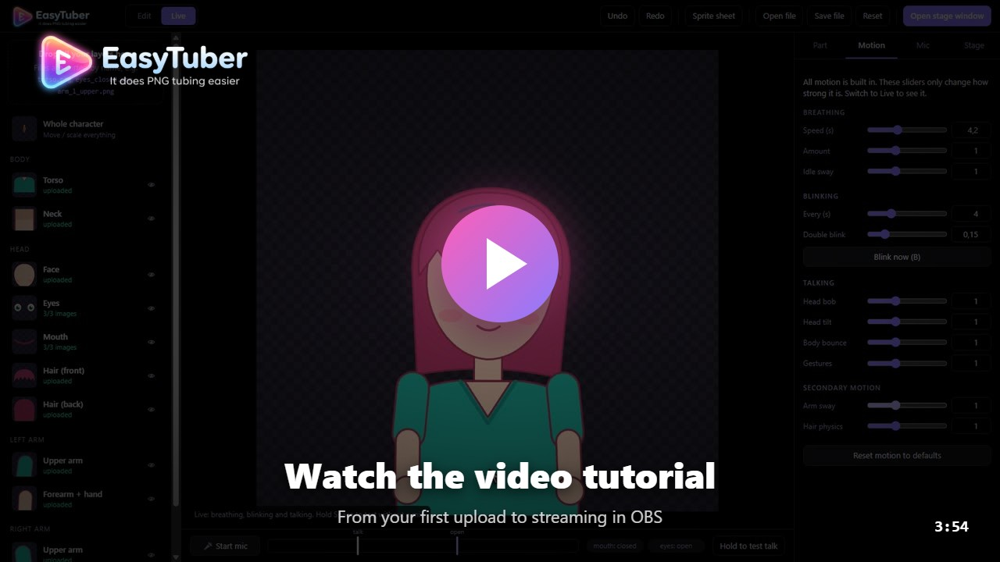</a>

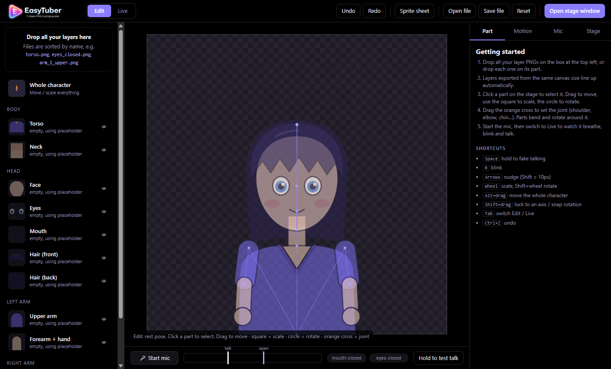

---

## Contents

1. [Install](#1-install)
2. [A tour of the window](#2-a-tour-of-the-window)
3. [Prepare your art](#3-prepare-your-art)
4. [Upload your parts](#4-upload-your-parts)
5. [Line up the rig (Edit mode)](#5-line-up-the-rig-edit-mode)
6. [Eyes and mouth](#6-eyes-and-mouth)
7. [Sprite sheets](#7-sprite-sheets)
8. [Set up your microphone](#8-set-up-your-microphone)
9. [Tune the motion](#9-tune-the-motion)
10. [Watch it live](#10-watch-it-live)
11. [Switch avatars with hotkeys](#11-switch-avatars-with-hotkeys)
12. [Actions: your own animations](#12-actions-your-own-animations)
13. [Stream it with OBS](#13-stream-it-with-obs)
14. [Save, back up and move your avatar](#14-save-back-up-and-move-your-avatar)
15. [Shortcuts](#15-shortcuts)
16. [Troubleshooting](#16-troubleshooting)
17. [For developers](#17-for-developers)

---

## 1. Install

Go to the [latest release](https://github.com/pjcjonas/EasyTuber/releases/latest) and download the file for your computer:

| Your computer | Download |
|---|---|
| Windows 10 / 11 | `EasyTuber-…-windows-x64.zip` |
| Mac with Apple silicon (M1, M2, M3, M4…) | `EasyTuber-…-macos-arm64.zip` |
| Mac with an Intel processor | `EasyTuber-…-macos-x64.zip` |

Not sure which Mac you have? Apple menu → **About This Mac**. "Chip: Apple M…" means Apple silicon; "Processor: Intel…" means Intel.

**Windows**

1. Unzip the file (right-click → **Extract All…**).
2. Open the `EASY-TUBER-win32-x64` folder and double-click **EASY-TUBER.exe**. Keep the whole folder together; you can pin the app to the taskbar or Start.
3. If Windows says *"Windows protected your PC"*, click **More info → Run anyway**. This appears because the app isn't code-signed yet.

**Mac**

1. Unzip the file and drag **EASY-TUBER.app** into **Applications**.
2. Open it. The app isn't notarised by Apple yet, so macOS blocks the first launch. Go to **System Settings → Privacy & Security**, scroll down and click **Open Anyway**, then confirm.
3. When it asks for the microphone, click **Allow**.

**The intro.** Each time the app starts it plays a short intro. Click anywhere or press any key to skip it.

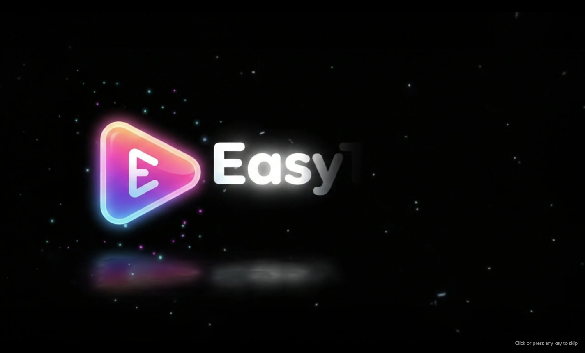

---

## 2. A tour of the window

| Area | What it's for |
|---|---|
| **Top bar** | **Edit / Live** switch, Undo / Redo, **Sprite sheet** cropper, **Open file / Save file**, **Reset**, and **Open stage window** |
| **Left panel** | The drop box for all your layers, and the list of body parts. Click a part to select it; the eye icon hides or shows it |
| **Centre** | The stage. The checkerboard square is the area OBS captures |
| **Bottom bar** | **Start mic**, the level meter with its **talk** and **open** markers, the mouth/eyes status, and **Hold to test talk** |
| **Right panel** | Six tabs: **Part** (the selected part), **Motion**, **Mic**, **Stage**, **Avatars** and **Actions** |

Until you upload your own art, every part shows a built-in placeholder character, so you can see the motion straight away.

---

## 3. Prepare your art

Draw your character in your art program as separate layers and export each layer as a **transparent PNG**.

* **Export every layer at the same canvas size** (full-canvas PNGs). Layers of the same size line up automatically when you upload them, so you'll barely need to move anything.
* Draw the parts a little bigger than where they meet, so no gaps open when they move: the neck goes under the face, the top of each arm goes under the torso.
* Name the files so EASY-TUBER can sort them for you (see the next section).

### The body parts

| Part | Images | Joint (where it bends) | Attached to |
|---|---|---|---|
| Torso | 1 | bottom centre (breathes upward from here) | — |
| Neck | 1 | base of the neck | torso |
| Face | 1 | chin (the head tilts from here) | neck |
| Eyes | open, half *(optional)*, closed | centre | face |
| Mouth | closed, half *(optional)*, open | centre | face |
| Hair (front) / Hair (back) | 1 each | top of the head | face |
| Left / right upper arm | 1 | shoulder | torso |
| Left / right forearm + hand | 1 | elbow | upper arm |

"Left arm" means the arm on the **left of the screen**. Only drew one arm? Upload it, select it and click **Mirror to other arm**.

---

## 4. Upload your parts

**The easy way:** select all your PNGs and drop them on **"Drop all your layers here"** at the top left (or click the box to pick them). Files are matched to parts by their names:

| Part | File names that work |
|---|---|
| Torso | `torso.png`, `body.png` |
| Neck | `neck.png` |
| Face | `face.png`, `head.png` |
| Eyes | `eyes_open.png`, `eyes_half.png`, `eyes_closed.png` (`blink` works too) |
| Mouth | `mouth_closed.png`, `mouth_half.png`, `mouth_open.png` |
| Hair | `hair_front.png` (or `bangs`), `hair_back.png` |
| Arms | `arm_l_upper.png`, `arm_l_lower.png`, `arm_r_upper.png`, `arm_r_lower.png` (`forearm` or `hand` also mean lower) |

**One at a time:** drop an image onto a part in the left list, or onto one of the image slots in the **Part** tab. Or click a slot to choose a file.

A part you've uploaded says **uploaded** in green in the list. Parts still using the placeholder say *empty, using placeholder*. You can turn the placeholder off in **Stage → Show placeholder art for empty parts**.

---

## 5. Line up the rig (Edit mode)

Make sure **Edit** is selected in the top bar. In Edit mode the character holds still in its rest pose and shows its skeleton: the lines are bones and the dots are joints.

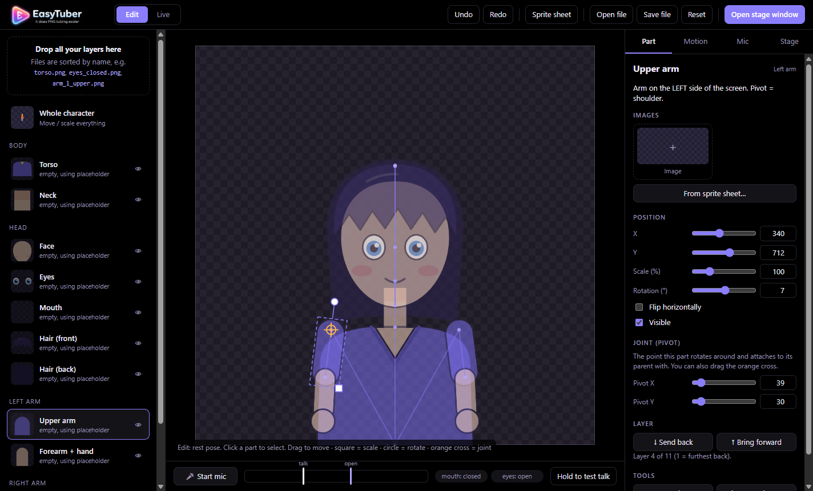

* **Click a part** on the stage (or in the left list) to select it. It gets a dashed box.
* **Drag** it to move it. The parts attached to it move too (you can switch that off in the Stage tab).
* Drag the **square** handle to scale and the **circle** handle to rotate.
* Drag the **orange cross** to set the **joint**: the shoulder, elbow, chin and so on. The part rotates around this point and attaches to its parent there, so put it where the part would really bend.
* Mouse **wheel** scales, **Shift+wheel** rotates, **arrow keys** nudge (Shift = 10 px), **Shift+drag** locks to an axis or snaps the rotation.
* **Alt+drag** (or the *Whole character* row) moves and scales the whole avatar inside the capture square.
* **Ctrl+Z** undoes, **Ctrl+Shift+Z** redoes.

The **Part** tab shows exact numbers for the selected part: position, scale, rotation, flip, visibility and the joint position. It also has:

* **Send back / Bring forward** to change the drawing order (or use the list in the Stage tab).
* **Tools**: re-fit the image and recompute the joint, and **Mirror to other arm**.

---

## 6. Eyes and mouth

Eyes and mouth have several images each. Select **Eyes** or **Mouth** to see their slots:

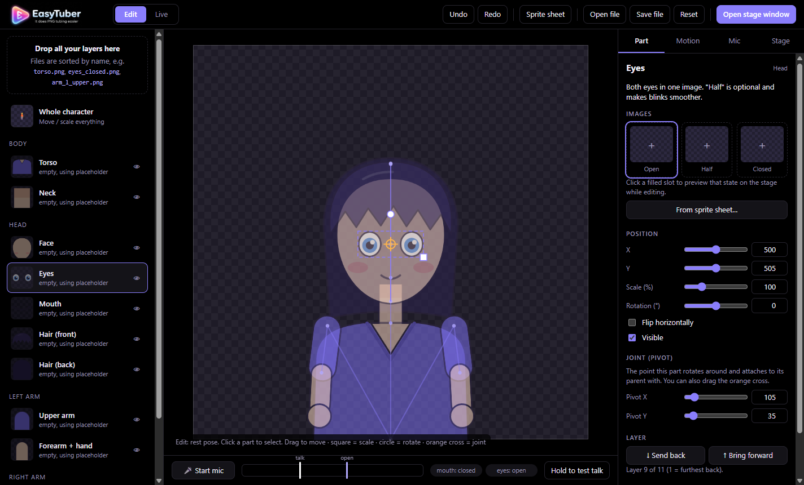

* **Eyes:** *Open*, *Half* and *Closed*. Half is optional and makes blinks smoother.
* **Mouth:** *Closed*, *Half* and *Open*. Half is optional; without it the open mouth is used for both.
* **Click a filled slot** to preview that state on the stage while you line it up.
* **Frame adjust** (appears once you've uploaded frames) moves or scales only the frame you're previewing, so a slightly misaligned frame lines up. The first frame shows faintly underneath (onion skin). **Next frame →** steps through the frames so you can check them.

---

## 7. Sprite sheets

You can put several frames, or several parts, in one image and crop them inside the app.

* **Eyes or mouth frames:** select the part and click **From sprite sheet…**. The sheet is split into one equal box per frame (side by side or stacked, guessed from the image's shape), and the boxes are assigned Open / Half / Closed in order. Drag the boxes or their handles to adjust them, then click **Crop into rig**.
* **Many parts on one sheet:** click **Sprite sheet** in the top bar. Sprites on a transparent background are boxed automatically. Pick a part for each box from its dropdown. Raise *"Join pieces closer than"* if a pair of eyes gets split into two boxes.
* Files with `sheet`, `sprite` or `atlas` in the name open the cropper automatically when dropped (`eyes_sheet.png` is pre-assigned to the eyes).
* **Keep all boxes the same size** is on for grids, so resizing one box resizes all of them and the frames stay aligned.
* In the cropper: drag on empty space to draw a box, use the wheel to zoom, right-drag or Space+drag to pan, arrow keys to nudge, and Delete to remove a box.
* Sheets are saved with the avatar, so **Edit sprite sheet crop…** (or **Stage → Sprite sheets**) reopens the boxes later.

---

## 8. Set up your microphone

1. Click **Start mic** in the bottom bar (allow the microphone if your computer asks).
2. Talk normally and watch the **meter**. The bar should pass the white **talk** marker on every word and the purple **open** marker on louder syllables.
3. Drag the **talk** marker to where the mouth should start opening, and the **open** marker to where it should open fully.

The **Mic** tab has the same settings as numbers, plus:

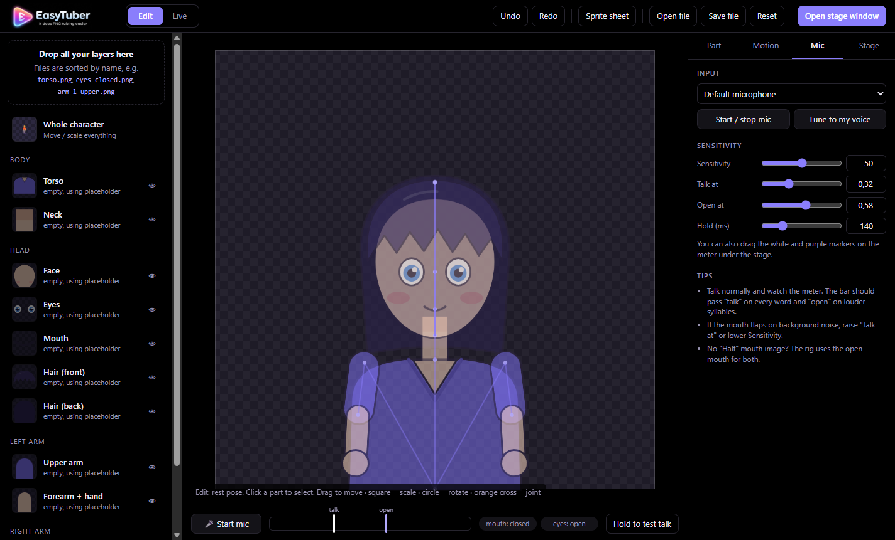

* **Input:** choose which microphone to use.
* **Tune to my voice:** click it, stay quiet while the button says *Stay quiet…* (1.5 s), then talk normally while it says *Now talk normally…* (3 s). It sets the markers from your room noise and your voice.
* **Sensitivity:** boosts or lowers the input level.
* **Hold (ms):** how long the mouth stays open after you stop. Longer is calmer.

If the mouth flaps on background noise, raise **Talk at** or lower **Sensitivity**.

No microphone handy? Hold **Space** (or the **Hold to test talk** button) to fake talking.

---

## 9. Tune the motion

All the motion is built in. The **Motion** tab only sets how strong each one is (1 is the default; 0 turns it off).

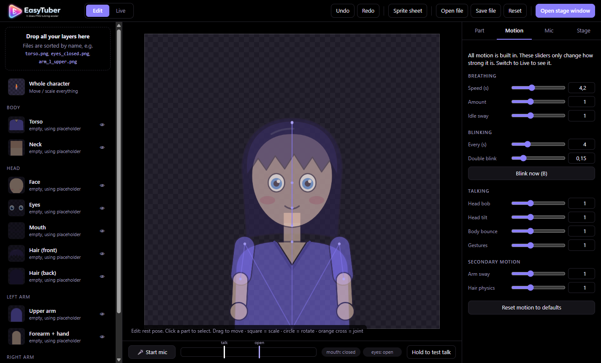

| Group | Sliders |
|---|---|
| **Breathing** | Speed (seconds per breath), Amount, Idle sway |
| **Blinking** | Every (seconds between blinks), Double blink (how often a blink comes in twos), **Blink now** |
| **Talking** | Head bob (hops on each syllable), Head tilt (rocks side to side), Body bounce, Gestures (arms move when you talk) |
| **Secondary motion** | Arm sway (idle arm movement), Hair physics (how much the hair swings after the head moves) |

**Reset motion to defaults** puts everything back to 1.

---

## 10. Watch it live

Click **Live** in the top bar (or press **Tab**). The skeleton disappears and the avatar breathes, blinks and talks. The status chips show what the mouth and eyes are doing.

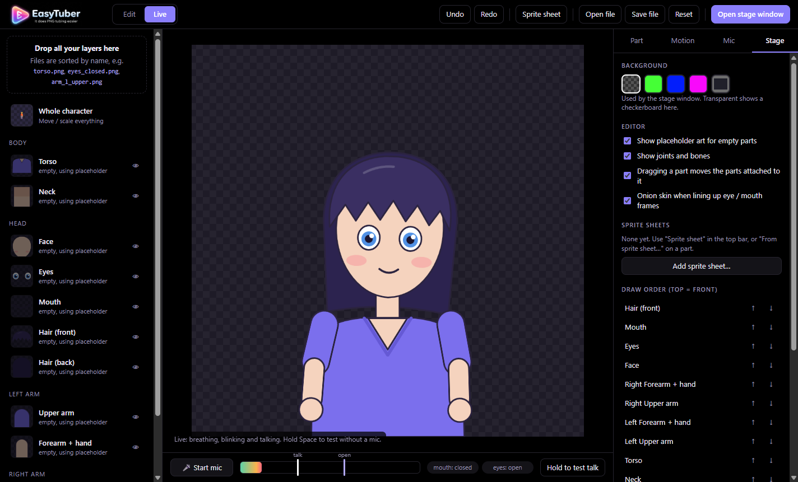

---

## 11. Switch avatars with hotkeys

Keep several avatars (outfits, moods, characters) and switch between them with keys on your keyboard, **even while you're in a game**. When you switch, the parts drop off the screen and the new avatar climbs back in, in the editor and in OBS.

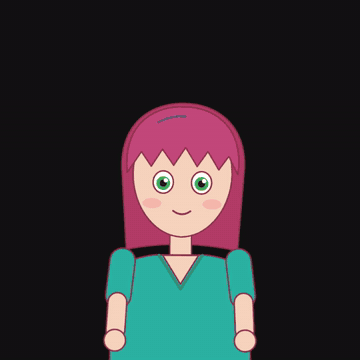

Open the **Avatars** tab:

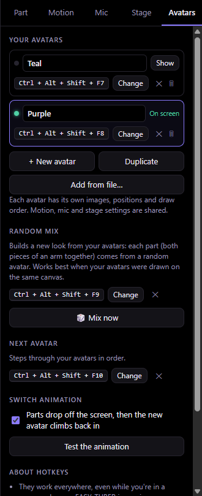

* **+ New avatar** starts a new one from the placeholder. **Duplicate** copies what's on screen, which is the quick way to make an outfit change or a different expression. **Add from file…** adds the avatars from a saved `.easytuber.json` (so avatars you made separately can live together).
* **Show** puts an avatar on screen. Rename an avatar by typing in its name box. Everything you edit (images, positions, joints, draw order) belongs to the avatar on screen. Motion, mic and stage settings are shared by all of them.
* **Set key**, then press the combination you want, such as **Ctrl+Alt+1**. Esc cancels; Backspace removes the key. A key needs Ctrl, Alt or Shift with it, except F-keys and numpad keys, which can be used alone. That's so your normal typing keeps working everywhere.
* **Random mix** builds a new look from your avatars: each part comes from a random avatar (both pieces of an arm always come from the same one). Give it a key, or click **🎲 Mix now**. Every press makes a new mix. Like one? **Keep this mix** saves it as an avatar. Mixing works best when your avatars were drawn on the same canvas, in the same pose.
* **Next avatar** steps through your avatars in order with one key.
* **Switch animation** turns the drop-out / climb-in effect on or off. **Test the animation** plays it here and in OBS.

Hotkeys work as long as EASY-TUBER is running, even minimised. While it runs, the keys you bind don't reach other programs, so pick combinations you don't use elsewhere. If another program already uses a combination, it shows in red: pick a different one.

---

## 12. Actions: your own animations

An action is an animation you play on demand: a wave, a spin, a prop that flies in. EASY-TUBER comes with none. Each action is one small file, and you can add as many as you like, including ones somebody else made.

**Add an action**

1. Open the **Actions** tab and click **Open actions folder**.
2. Put the action's `.js` file in that folder. If it came with a folder of pictures or sounds, put that folder there too.
3. Click **Reload actions**. The action appears in the list, and the stage window and OBS load it as well.

To remove an action, delete its file and click **Reload actions**. If a file has a mistake in it, it is skipped and the Actions tab tells you which file and why.

Only add action files you trust. An action is a small program that runs inside EASY-TUBER.

**Play an action**

* **▶ Test** plays it in the editor, the stage window and OBS at the same time.
* **Set key** gives it a global hotkey, with the same rules as the avatar hotkeys.
* **Settings** holds the action's **Cooldown** and its own sliders and checkboxes, when it has any. They are saved with your avatar file.
* **Cooldown** is how many seconds Streamer.bot has to wait before it can play the action again, so chat can't spam it. Test and your own hotkeys always play. 0 means no cooldown.

**Actions that stay on.** Some actions are *held*: they stay on until you turn them off, like a "be right back" pose. Their button says **▶ Turn on** and then **■ Turn off**, and their hotkey switches them the same way. **■ Stop all actions** stops everything that is playing.

**Sounds.** Some actions come with sounds. Under **Sounds** in the Actions tab, choose where they play, and set one volume for all of them:

* **In EASY-TUBER (this window)** plays through your speakers. Your stream hears it if you capture desktop sound, and so do you.
* **In the OBS source or stage window** plays inside OBS. On the Browser Source, tick **Control audio via OBS** to give the sounds their own slider in the mixer.
* **Nowhere (muted)** turns them off.

**Play it from Streamer.bot**

1. Under **Streamer.bot** in the Actions tab, pick an action. To play several in a row, pick each one and click **Add to sequence** (up to 8 steps, and avatar switches can be steps too).
2. Click **Copy** to copy the address.
3. In Streamer.bot on the same computer, add a **Fetch URL** sub-action and paste the address. Add the header `X-EasyTuber-Control` with the value `streamerbot`.

4. For a held action, the address turns it on, and off again if it is already on. The tab shows the two other addresses you may want: one that only turns it on, and one that turns it off. Use those when one trigger starts it and another ends it.
5. Some actions use values, such as a name to show. Type them in **Values for the action**, for example `user=%user%&amount=500`, and they are added to the address. Streamer.bot fills in its own variables, like `%user%`, when it sends it.

**Saved sequences.** Click **Save sequence** to keep the sequence you built, with its timing and values. Under **Saved sequences** you can name it, **▶ Play** it, give it a global hotkey with **Set key**, and **Copy address** for Streamer.bot. The address is short and stays the same when you change the sequence later.

When several requests arrive close together, sequences play one after another: up to 20 wait in a queue. A single action plays straight away; add `&queue=1` to its address to make it wait its turn too.

Keep EASY-TUBER running while you stream.

**Write your own.** [js/actions/README.md](js/actions/README.md) describes the file: how to move parts, change the eyes and mouth, and draw in front of or behind the avatar.

---

## 13. Stream it with OBS

EASY-TUBER serves your avatar on a local web address for OBS: `http://localhost:8777/?stage=1`. The **Stage** tab shows this address with a **Copy** button.

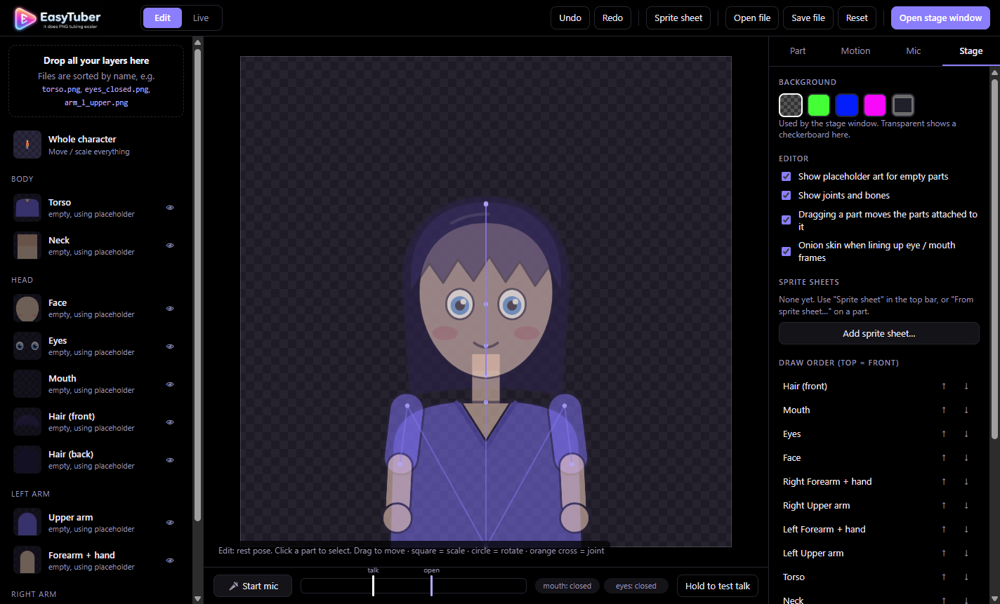

### Browser Source (recommended: transparent, no chroma key)

1. Keep EASY-TUBER open with **Start mic** on. It can be minimised.
2. In OBS: **Sources → + → Browser**. Paste the address, set width **1920** and height **1080**.
3. Leave the Stage background on **Transparent** (the checkerboard swatch).

The app's microphone drives the avatar in OBS, and your edits show up in OBS straight away. If port 8777 is busy (another copy is already running, for example), the app uses the next free port, warns you, and the Stage tab shows the new address.

### Window Capture (alternative)

1. In the **Stage** tab, choose **green**, **blue** or **magenta** as the background.
2. Click **Open stage window** in the top bar.
3. In OBS, add a **Window Capture** of *"EASY-TUBER Stage"* and give it a **Chroma Key** filter with the same colour.

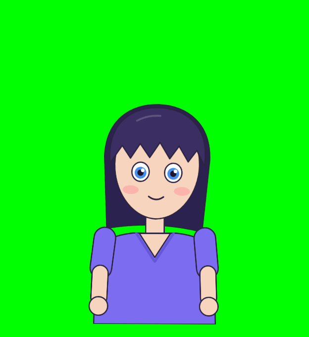

### Virtual camera (Zoom, Discord, Teams and other programs)

EASY-TUBER can show your avatar as a camera, so any program that takes a webcam can use it. It works on Windows and on a Mac.

1. Install [OBS Studio](https://obsproject.com) (version 30 or newer on a Mac). EASY-TUBER uses the camera that OBS installs; OBS doesn't have to be running.
   * **Mac only, once:** open OBS, click **Start Virtual Camera**, allow the camera extension in **System Settings**, then click **Stop Virtual Camera**. Needs macOS 13 or newer.
2. In the **Stage** tab, click **Start camera**.
3. In your call or chat program, choose **OBS Virtual Camera** as the camera.

The camera picture is 1920 × 1080 at 30 frames a second. A camera can't be transparent: the Stage background colour is used, and **Transparent** shows black. The microphone, blinking, motion and avatar hotkeys all work the same as on the stage. Only one program can send to the camera at a time, so stop OBS's own virtual camera first.

The **Stage** tab also has the editor options (placeholder art, joints and bones, dragging attached parts, onion skin), your saved sprite sheets, and the full **draw order** list.

---

## 14. Save, back up and move your avatar

* **Your avatar saves itself** every time you change something, to:
  * Windows: `%APPDATA%\EASY-TUBER\avatar.easytuber.json`
  * Mac: `~/Library/Application Support/EASY-TUBER/avatar.easytuber.json`
* **Your pictures are files** in the `images` folder beside it. The avatar file only names them, so it stays small and saves quickly however much art you have. A picture used by several avatars is stored once.
* **Save file** downloads the avatar as one `.easytuber.json` file with the pictures inside it. Use it for backups or to move to another computer.
* **Open file** loads a saved `.easytuber.json`.
* **Reset** removes all uploads and settings. Save a file first if you might want them back.

To move or back up an avatar, use **Save file**. Copying `avatar.easytuber.json` on its own leaves the pictures behind, and **Open file** will say so.

**Coming from v1.8 or older.** The first time this version starts, it moves the pictures out of your avatar file into the `images` folder. The file as it was is kept beside it as `avatar.easytuber.json.before-images.bak`; you can delete it once you are happy.

A picture that no avatar uses any more is removed from the `images` folder a month later.

An avatar made with the old browser version (`saved\avatar.pngtuber.json` next to the app) is imported on first launch.

---

## 15. Shortcuts

| Key | Action |
|---|---|
| **Space** (hold) | Fake talking |
| **B** | Blink |
| **Tab** | Switch Edit / Live |
| **Arrows** | Nudge the selected part (Shift = 10 px) |
| **Wheel** / **Shift+wheel** | Scale / rotate the selected part |
| **Alt+drag** | Move the whole character |
| **Shift+drag** | Lock to an axis / snap rotation |
| **Ctrl+Z** / **Ctrl+Shift+Z** | Undo / redo |
| **F5** | Reload |
| **F12** | Developer tools |
| *Your avatar hotkeys* | Switch avatar, next avatar, random mix (set in the Avatars tab; work in any program) |
| *Your action hotkeys* | Play an action or a saved sequence (set in the Actions tab; work in any program) |

On a Mac, use **Cmd** where this says Ctrl.

---

## 16. Troubleshooting

| Problem | Fix |
|---|---|
| The meter doesn't move | Check the **Mic → Input** choice. On a Mac, allow EASY-TUBER in **System Settings → Privacy & Security → Microphone**. On Windows, check **Settings → Privacy → Microphone**. |
| The mouth flaps on noise | Raise **Talk at** or lower **Sensitivity**, or use **Tune to my voice**. |
| The avatar doesn't move in OBS | Keep EASY-TUBER open with the mic on. Check the Browser Source address matches the one in the Stage tab. |
| **Start camera** says it needs OBS Studio | Install OBS Studio. On a Mac, also start and stop its virtual camera once and allow the camera extension in System Settings. |
| **Start camera** says another program is sending | Stop the virtual camera in OBS (or the other program), then click **Start camera** again. |
| "OBS Virtual Camera" isn't in the program's camera list | Restart that program after installing OBS. On a Mac, allow EASY-TUBER in **System Settings → Privacy & Security → Camera**. |
| Gaps open between parts when they move | Move the joint (orange cross) to where the part really bends, and draw the part a little bigger under its neighbour. |
| An avatar hotkey does nothing | Check it isn't red in the Avatars tab (red means another program has it). Keep EASY-TUBER running. On a Mac, some combinations are reserved by macOS; try another. |
| "Windows protected your PC" | Click **More info → Run anyway**. |
| The Mac says the app can't be opened | **System Settings → Privacy & Security → Open Anyway**. If it says the app is damaged, run `xattr -cr /Applications/EASY-TUBER.app` in Terminal and open it again. |

---

## 17. For developers

**Run from source** (needs [Node.js](https://nodejs.org) 22 or later):

```sh
npm install
npm start
```

On Windows you can also double-click `start.bat`.

**Tests:** `npm test`

**Build the app**

```sh
npm run dist:win   # dist/EASY-TUBER-win32-x64/EASY-TUBER.exe
npm run dist:mac   # dist/EASY-TUBER-darwin-arm64 and -x64 (build this on a Mac)
```

**Releases** are built by GitHub Actions (`.github/workflows/release.yml`). Push a version tag and it builds Windows on a Windows runner and both Macs on a macOS runner, then publishes a GitHub Release with the three zips:

```sh
# bump "version" in package.json first
git tag v1.0.1
git push origin v1.0.1
```

**Icons.** `python build/make-icon.py` rebuilds `icon.png`, `icon.ico`, `icon.icns` and the top-bar `logo.jpg` from `build/logo-source.jpg` (needs ffmpeg).

**Files**

```
electron/main.js    desktop app window, mic permission, stage window
electron/server.js  local server: serves the app to OBS, saves the avatar file, relays the mic, lists and plays actions
electron/images.js  the avatar's pictures as files: storing, moving them out of an old avatar file, clearing unused ones
electron/vcam.js    virtual camera: sends frames to the OBS Virtual Camera driver (Windows and macOS, through koffi)
build/              logo, icons, the macOS microphone and camera permission text
media/intro.mp4     the start-up intro
index.html          page shell (editor; ?stage=1 = clean capture page for OBS; &cam=1 = the copy filmed for the virtual camera)
css/style.css
js/intro.js         the intro overlay
js/defs.js          parts, hierarchy, default layout and settings, filename routing
js/animator.js      breathing, blinking, lip-sync, head/arm/hair motion
js/avatars.js       avatar layouts, global hotkeys, random mix, switching
js/transition.js    the drop-out / climb-in switch animation
js/actions.js       loads and runs actions (your own animations)
js/actions/         actions built into the app (none), and README.md: how to write one
js/renderer.js      skeleton pose math + drawing
js/editor.js        canvas editing, uploads/auto-alignment, mirroring, undo
js/sheet.js         sprite sheet cropper
js/panels.js        side panels
js/audio.js         microphone level
js/assets.js        image cache, hit-testing masks
js/storage.js       avatar file + browser storage + messaging to the stage page
js/placeholder.js   built-in placeholder character
js/app.js           boot + main loop
docs/screenshots/   the pictures in this README
tests/              npm test (server, avatar, action and camera logic)
docs/tutorial-thumbnail.jpg  the video tutorial's preview picture
```
